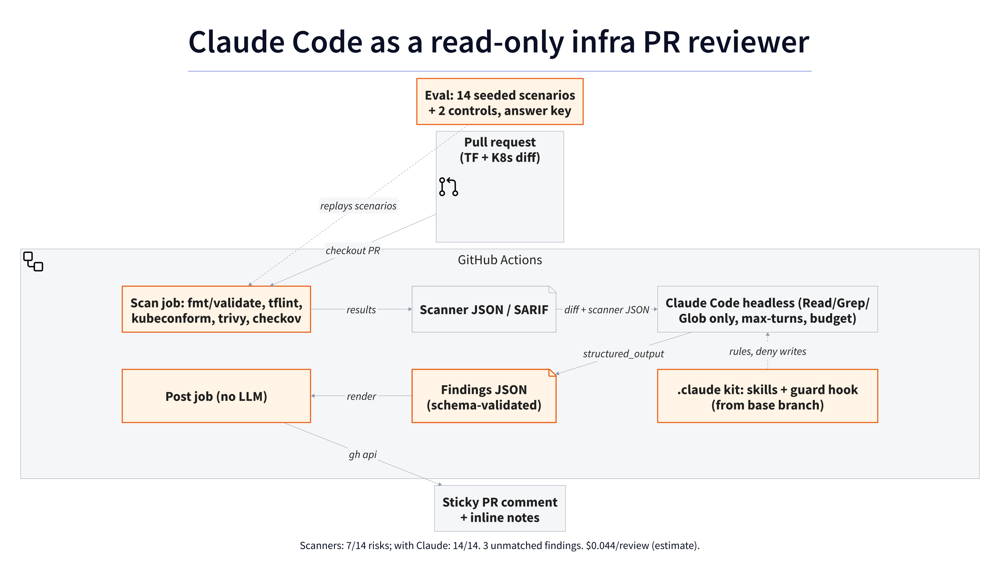

# claude-infra-review

[](https://github.com/H-Nizami/claude-infra-review/actions/workflows/ci.yml)

> **Result:** Scanners alone caught 7/14 seeded misconfigs; with Claude 14/14, with 3 false positives, at $0.043785 per PR (estimated: tokens × list price).

Claude Code as a read-only infra reviewer: Terraform/OpenTofu and Kubernetes
changes checked by deterministic scanners first, then explained and risk-ranked
by Claude, with estimated-spend reservations and no write access.



## Architecture

The scanner pipeline runs `fmt`/`validate`, tflint, kubeconform, trivy, and checkov,
normalizing their output into one JSON file. The optional Claude pass reads the
diff and scanner evidence with Read/Grep/Glob, a turn limit, and a per-call budget.
It returns schema-validated findings. Executable review code, the prompt, schema,
and guard come from a trusted checkout; PR files are data. A separate job renders
and posts a sticky comment and inline notes with no model or OAuth secret.

The eval harness replays 14 seeded scenarios and two negative controls, scoring
scanners and final model output separately against fixed answer keys. Scanner
predictions remain unchanged after observation. See the
[evaluation report](eval/results/latest.md); the measured scanners-only result is **7/14 seeded risks detected, with zero
negative-control findings**. Claude caught **14/14** with **3 unmatched findings** under the answer key, at an
average **$0.043785 per review (estimate)**. Both negative controls were clean; the
prompt-injection finding was also detected. Each scenario has one successful
review; S14 and the controls ran in a continuation after interruption.

Live demo output: [posted review comment](docs/examples/demo-comment.md),
[saved findings](docs/examples/demo-findings.json), and
[numeric usage](docs/examples/demo-run-meta.json).

Source: [`docs/architecture.d2`](docs/architecture.d2), rendered with `make diagram`.

## Quickstart

```bash
python3 -m venv .venv
. .venv/bin/activate
python3 -m pip install -r requirements.txt -r requirements-scan.txt
make tools
scripts/scan.sh . /tmp/cir-baseline
python3 eval/run.py --scenarios all --out .cache/scanners-replay
make lint test diagram
```

Python 3.12, git, curl, shellcheck, and kubectl (or kustomize) are prerequisites.
Pinned binaries are installed into `.bin/` with checksum verification. Scanner
runs download providers and schema/check data; Docker, AWS credentials, and a
running cluster are unnecessary. Infrastructure is validated, never applied.

Live review is off by default. A run needs `CIR_REVIEW_ENABLED`, the
`claude-review` label and a precharged spend reservation; see the
[activation guide](docs/activation.md) and [team playbook](docs/playbook.md).
Local live eval also requires `CIR_ALLOW_CLAUDE=1`.

A [two-minute walkthrough](docs/demo.md) covers the design and results.

## Design decisions

- [0001 Record decisions](docs/decisions/0001-record-decisions.md)
- [0002 Claude gets no GitHub write tools; a deterministic step posts the comment](docs/decisions/0002-no-github-write-tools-for-claude.md)
- [0003 Scanners first, with auditable deduplication](docs/decisions/0003-scanners-before-claude.md)
- [0004 Fail-closed guard and trusted code](docs/decisions/0004-fail-closed-review-guard.md)
- [0005 Estimated spend reservations](docs/decisions/0005-estimated-spend-ledger.md)
- [0006 Headless CLI schema and settings](docs/decisions/0006-headless-cli-schema-and-settings.md)
- Pinned action SHAs and tool versions: [docs/pins.md](docs/pins.md)

## Limits

- Detection is measured on seeded scenarios, not on real-world PRs.
- With subscription auth the cost per PR is an estimate (token counts × list price), not a bill.
- Model output is non-deterministic; this small seeded set has one successful review
  per scenario, including a continuation after interruption.
- Three unmatched findings remain in S04, S12, and S13: lower-severity or duplicate
  scanner warnings carried into the final review. The answer keys were not changed.
- Local reservations stop new calls without allowance; usage already consumed
  cannot be undone if the CLI exceeds its limit. CI needs a precharged reservation
  for its exact head and run attempt. These are estimated-spend controls.
- Scanner providers and schema/check downloads need network access. No cloud plan
  validates replacement or actual service costs in this fixture suite.

## How I'd do this for your team

- Discovery: look at your IaC layout, the scanners you already run, and the review comments your team writes by hand most often.
- Adapt: tune the scanner set, the severity rubric and the review skills to your policies (residency, cost, naming), and seed scenarios from your own past incidents.
- Measure: run the eval on your seeded scenarios before rollout, so the team sees detection and false-positive rates up front.
- Roll out: start as a non-blocking comment on a few repos, with a per-run budget and no write access.
- Hand over: the workflow, kit, eval harness and a playbook your platform team owns.

## Status

| Stage | Scope | Status |
|---|---|---|
| 1 | Scaffold: standard files, CI, cover diagram | Complete |
| 2 | Scanners, eval, workflow, team kit, playbook | Complete: measured eval and live CI demo verified |

## License

Apache-2.0. See LICENSE.
